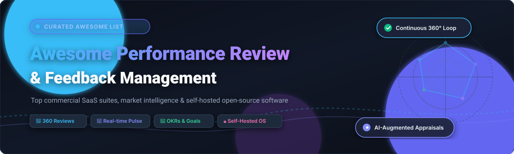

# 🌟 Awesome Performance Review &amp; Feedback Management 🌟

  
  
  
  
  

  <strong>🎯 Curated repository of top Performance Review platforms, Continuous Feedback tools, 360-Degree Evaluations, and Employee Appraisal suites.</strong>
   
  <em>Featuring enterprise SaaS intelligence, detailed pricing tiers, transparent free trial terms, and production-grade self-hosted open-source software.</em>

---

## 📑 Table of Contents 📌

- [📈 Sector Overview & Market Dynamics](#-sector-overview--market-dynamics-)
- [🏢 Commercial SaaS Platforms](#-commercial-saas-platforms-)
- [💻 Open-Source Solutions](#-open-source-solutions-)
  - [1. 🚀 Horilla HRMS](#1--horilla-hrms-)
  - [2. 🤖 MintHCM](#2--minthcm-)
  - [3. 🎯 HRPulsar](#3--hrpulsar-)
  - [4. 🔄 threesixty](#4--threesixty-)
  - [5. 💬 Thinksy](#5--thinksy-)
  - [6. 🛡️ Blik](#6-️-blik-)
  - [7. ⚙️ Evalytics](#7-️-evalytics-)
  - [8. 👥 Check-Ins](#8--check-ins-)
  - [9. 🔐 PIX 360](#9--pix-360-)
  - [10. 📋 Caliber](#10--caliber-)
  - [11. 🕸️ Feedback360](#11-️-feedback360-)
  - [12. 📊 EPMS](#12--epms-)
- [📊 Feature Comparison Matrix](#-feature-comparison-matrix-)
- [🌟 Star History](#-star-history-)
- [💖 Support & Sponsorship](#-support--sponsorship-)
- [🤝 Contributing](#-contributing-)
- [📄 License](#-license-)

---

## 📈 Sector Overview & Market Dynamics 🌐

The global **Employee Performance Management & Continuous Feedback Software** market is currently valued at approximately **$6.3 billion to $8.0 billion** and is projected to expand to **$15.0 billion – $18.0+ billion** by 2033–2035, accelerating at a robust compound annual growth rate (CAGR) of **10.5% – 13.5%**. 🚀

The sector is characterized by **moderate to high fragmentation** rather than a winner-take-all monopoly 🧩:
* 🏛️ **Enterprise Monoliths:** Traditional HCM giants (Workday, SAP SuccessFactors, Oracle HCM, ADP) capture roughly ~47% of consolidated enterprise spend for organizations demanding unified payroll, core HR, and compliance records.
* ⚡ **Agile Modern Specialists:** The majority share is actively contested across specialized point-solution providers (Lattice, Culture Amp, 15Five, Leapsome) and self-hosted tools.
* 🔄 **Paradigm Evolution:** Growth and fragmentation are propelled by cloud-native deployment flexibility, hybrid workforce dynamics, and a rapid transition away from outdated annual appraisals toward real-time 360° loops, weekly check-in cadences, OKR tracking, and AI-assisted performance feedback.

---

## 🏢 Commercial SaaS Platforms 💼

Below is the comparative breakdown of top commercial cloud platforms for continuous performance reviews, 360 evaluations, OKRs, and employee engagement, **sorted by company size (valuation / estimated ARR descending)**. 🏆

| 🏢 Platform | 💰 Starting Tier Pricing | 🎁 Free Tier / Free Trial Limits | 📊 Company Size (Valuation / ARR) | 🎯 Primary Focus & Capabilities |
|:---|:---|:---|:---|:---|
| **[Lattice](https://lattice.com)** | **$4.00/seat/month** (Engagement) / **$10.00/seat/month** (Performance module; minimum annual commitment spend: $4,000/year) | **No free tier & no public self-serve trial**; evaluation requires booking a sales-guided live demo or interactive website walkthrough | **Valuation: $3.0B** (Series F) / **ARR: ~$115M – $127M+** | 🌟 Enterprise-grade performance reviews, 360 feedback, continuous 1:1 agendas, goal/OKR cascading, and talent analytics. |
| **[Culture Amp](https://cultureamp.com)** | **$3,300.00/year base minimum** (approx. $3.00 – $6.00/seat/month scaled by module headcount) | **No free tier & no public self-serve trial**; prospective enterprise clients must request a custom consultation and guided sandbox demo | **Valuation: $1.5B** (Series F) / **ARR: ~$177M – $227M+** | 🧠 People analytics, employee experience benchmarks, deep pulse & climate engagement surveys, and 360 performance calibrations. |
| **[15Five](https://15five.com)** | **$4.00/user/month** (Engage plan) / **$11.00/user/month** (Perform plan; billed annually) | **14-day free trial** (full access without upfront contract requirement); no perpetual free tier | **Valuation: ~$500M+** (Est.) / **ARR: ~$100M – $150M** | ⏱️ Continuous performance management based on weekly check-ins, 1:1 meeting prep, objectives/OKRs, and AI-assisted performance reviews. |
| **[Leapsome](https://leapsome.com)** | **$5.00 – $8.00/user/month** (Base module; annual contract starting floor ~$9,600/year, startup discounts available) | **14-day free trial** (unrestricted feature testing with no credit card required); no perpetual free tier | **Valuation: ~$300M – $800M** (Series A) / **ARR: ~$30M – $45M+** | 🌱 All-in-one mid-market people enablement suite combining structured 360 reviews, goal alignment, competency frameworks, and engagement surveys. |
| **[Betterworks](https://betterworks.com)** | **$8.00/user/month** (Performance tier, billed annually) | **No free tier & no public self-serve trial**; enterprise evaluation requires an interactive enterprise demo and tailored proof-of-concept setup | **Valuation: ~$177M** / **ARR: ~$22M – $42M** | 🎯 Enterprise OKRs alignment, continuous coaching, anytime talent calibration, succession planning, and AI performance intelligence. |

---

## 💻 Open-Source Solutions 🔓

A curated collection of production-ready open-source and self-hosted tools for employee evaluations, 360-degree feedback, and continuous check-ins, **sorted by GitHub star count (descending)**. 🌟

### 1. 🚀 Horilla HRMS 
* **Repository:** [horilla/horilla-hr](https://github.com/horilla/horilla-hr)
* **Stack:** 🐍 Python 3.12–3.14 / Django / PostgreSQL / 🐳 Docker
* **License:** 📜 LGPL-2.1
* **Overview:** A modern, feature-rich HR management system with a dedicated **Performance Management** module supporting goal setting, KRAs, periodic appraisal cycles, and continuous peer feedback.
* **Key Features:**
  - 📋 Full employee appraisal workflow with manager evaluations and self-assessments
  - 👥 Comprehensive employee lifecycle tracking (LDAP integration, attendance, leave, payroll)
  - 🔌 REST API with token authentication and third-party integrations (Google Meet, WhatsApp)
  - 🛡️ Production-ready Docker Compose deployment with role-based access control (RBAC)

### 2. 🤖 MintHCM 
* **Repository:** [minthcm/minthcm](https://github.com/minthcm/minthcm)
* **Stack:** 🐘 PHP / Elasticsearch / 🐳 Docker
* **License:** 📜 AGPL-3.0
* **Overview:** An open-source Human Capital Management platform architected for full enterprise data sovereignty, featuring AI-native interfaces and MCP/A2A connectivity for automating performance evaluations.
* **Key Features:**
  - 📊 Centralized performance evaluation records and employee skill matrix
  - 🤖 Model Context Protocol (MCP) compatible APIs enabling AI assistants to participate in HR workflows
  - 🔐 Complete data ownership without cloud lock-in
  - 🌐 Broad HR footprint covering onboarding, leave management, and career progression

### 3. 🎯 HRPulsar 
* **Repository:** [HRPulsar/hrpulsar](https://github.com/HRPulsar/hrpulsar)
* **Stack:** ⚡ Python (FastAPI) / Next.js / TypeScript / 🐳 Docker
* **License:** 📜 AGPL-3.0
* **Overview:** A modern open-source talent and competency management platform specifically built for 360° assessments, skill frameworks, and automated employee development plans.
* **Key Features:**
  - 🔄 Multi-rater 360-degree feedback cycles (self, peers, managers, direct reports)
  - 🧭 Competency matrices and gap analysis dashboards
  - 📈 Individual development plans (IDPs) linked directly to review results
  - ✨ AI-assisted appraisal summary generation and custom evaluation surveys

### 4. 🔄 threesixty 
* **Repository:** [thermondo/threesixty](https://github.com/thermondo/threesixty)
* **Stack:** 🐍 Python / Django / ⚛️ React
* **License:** 📜 MIT
* **Overview:** A dedicated, lightweight internal 360-degree feedback tool developed by Thermondo to streamline peer reviews, manager feedback, and team retrospectives.
* **Key Features:**
  - 📝 Simple creation and distribution of 360-degree review questionnaires
  - 🕶️ Anonymous multi-perspective feedback aggregation
  - 👤 Self-service employee dashboard for viewing completed reviews
  - 📦 Straightforward self-hosted deployment

### 5. 💬 Thinksy 
* **Repository:** [Thinksy-app/thinksy](https://github.com/Thinksy-app/thinksy)
* **Stack:** 🐍 Python / 💬 Slack API / Node.js
* **License:** 📜 MIT
* **Overview:** A self-hosted Slack bot application that captures daily achievements and summarizes work history for performance reviews and regular check-ins.
* **Key Features:**
  - ✍️ Continuous feedback and brag-sheet logging directly from Slack channels
  - 📅 Automated weekly and quarterly achievement summaries
  - 🎯 Prevents recency bias during annual and semi-annual performance reviews
  - 🔒 Privacy-first self-hosted architecture

### 6. 🛡️ Blik 
* **Repository:** [thijsdezoete/blik](https://github.com/thijsdezoete/blik)
* **Stack:** 🐍 Python (Django 5) / Django REST Framework / 🐳 Docker
* **License:** 📜 Open Source
* **Overview:** A modern, privacy-first open-source 360 review tool designed as a lightweight self-hosted alternative to Lattice and Culture Amp.
* **Key Features:**
  - 🕶️ Anonymous 360-degree feedback cycles
  - 📐 Custom competency definitions and survey builder
  - ⏱️ Real-time review completion tracking
  - 🚀 Single-command Docker Compose deployment

### 7. ⚙️ Evalytics 
* **Repository:** [eduardogr/evalytics](https://github.com/eduardogr/evalytics)
* **Stack:** 🐍 Python / ☁️ Google Cloud Platform
* **License:** 📜 Apache-2.0
* **Overview:** An HR orchestration engine specifically designed to manage and automate end-to-end performance review cycles across distributed engineering and product organizations.
* **Key Features:**
  - 📨 Automated evaluation distribution to reviewers and managers
  - 🧩 Reviewer matrix validation to ensure sufficient multi-angle feedback
  - 📑 Secure report generation with aggregated qualitative and quantitative ratings
  - 💻 Command-line and scriptable review orchestration

### 8. 👥 Check-Ins 
* **Repository:** [objectcomputing/check-ins](https://github.com/objectcomputing/check-ins)
* **Stack:** ☕ Micronaut (Java) / ⚛️ React / ☁️ Google Cloud
* **License:** 📜 Open Source
* **Overview:** An enterprise team engagement and review platform created by Object Computing for periodic check-ins, mentor touchpoints, and employee evaluations.
* **Key Features:**
  - 🗓️ Performance review workflows with custom frequency (quarterly, biannual, annual)
  - 🎉 Continuous feedback tools, pulse surveys, and public kudos with Slack integration
  - 🤝 Structured mentor-mentee relationship tracking and check-in logs
  - 🔑 Enterprise Google SSO authentication

### 9. 🔐 PIX 360 
* **Repository:** [1024pix/pix-360](https://github.com/1024pix/pix-360)
* **Stack:** 💎 Ruby / Rails / PostgreSQL
* **License:** 📜 AGPL-3.0
* **Overview:** A specialized application by 1024pix built for managing confidential and end-to-end encrypted 360-degree peer appraisals within an organization.
* **Key Features:**
  - 🔒 End-to-end encrypted evaluation responses for maximum participant privacy
  - ✉️ Email-based review solicitation and real-time status alerts
  - 🛡️ Google SSO organizational gating
  - ⚡ Lightweight single-purpose 360 evaluation architecture

### 10. 📋 Caliber 
* **Repository:** [shiphrahx/Caliber](https://github.com/shiphrahx/Caliber)
* **Stack:** 📘 TypeScript / ⚛️ React / Node.js
* **License:** 📜 Open Source
* **Overview:** A management platform designed for engineering managers to run continuous 1:1s, collect real-time performance evidence, and proactively prevent review surprises.
* **Key Features:**
  - 🚨 "Attention Signals" alerting managers to overdue 1:1s or aging action items
  - 📝 Continuous evidence log linked directly to team members for annual reviews
  - 📌 Structured 1:1, retro, planning, and standup agenda templates
  - 📈 Career framework mapping and individual development gap analysis

### 11. 🕸️ Feedback360 
* **Repository:** [nashjain/feedback360](https://github.com/nashjain/feedback360)
* **Stack:** 🟨 JavaScript / Node.js / HTML5
* **License:** 📜 MIT
* **Overview:** A web-based 360-degree feedback platform facilitating multi-source evaluation surveys with visual competency radar charts.
* **Key Features:**
  - 👥 Configurable team review groups and participant assignments
  - ⚖️ Self-ratings mapped against peer and supervisor scores
  - 🕸️ Visual spider/radar chart output comparing competencies
  - 📑 Clean exportable performance evaluation summaries

### 12. 📊 EPMS 
* **Repository:** [Muadh2002/Employee-Performance-Review-System](https://github.com/Muadh2002/Employee-Performance-Review-System)
* **Stack:** ⚛️ React (Vite) / Tailwind CSS / Node.js (Express) / 🍃 MongoDB Atlas
* **License:** 📜 MIT
* **Overview:** A modern full-stack employee performance review and KPI tracking application designed as an agile reference implementation.
* **Key Features:**
  - 🔐 Role-based access control (Admin, Manager, Employee) with JWT authentication
  - 📈 Interactive performance metrics, goal progression, and review scorecards
  - 🔔 Automated performance reminder notifications
  - 📑 PDF and Excel performance report exports

---

## 📊 Feature Comparison Matrix 🔍

| 🛠️ Solution | 🏷️ Model / License | 💻 Tech Stack | 🔄 360 Feedback | ⏱️ Continuous Check-Ins | 🎯 OKRs / Goals | 📈 Analytics / Radar | 🏠 Self-Hosted | 💡 Target Use Case |
|:---|:---|:---|:---:|:---:|:---:|:---:|:---:|:---|
| **Lattice** | Commercial | Cloud SaaS | ✅ | ✅ | ✅ | ✅ | ❌ | Full enterprise performance & engagement |
| **Culture Amp** | Commercial | Cloud SaaS | ✅ | ✅ | ✅ | ✅ | ❌ | People analytics, eNPS & culture benchmarks |
| **15Five** | Commercial | Cloud SaaS | ✅ | ✅ | ✅ | ✅ | ❌ | High-cadence weekly check-ins & reviews |
| **Leapsome** | Commercial | Cloud SaaS | ✅ | ✅ | ✅ | ✅ | ❌ | Mid-market talent enablement & 360 reviews |
| **Betterworks** | Commercial | Cloud SaaS | ✅ | ✅ | ✅ | ✅ | ❌ | Enterprise OKRs alignment & continuous coaching |
| **Horilla HRMS** | LGPL-2.1 | Python / Django | ✅ | ✅ | ✅ | ✅ | ✅ | Comprehensive open-source HR suite with appraisal |
| **MintHCM** | AGPL-3.0 | PHP / Docker | ✅ | ✅ | ✅ | ✅ | ✅ | AI-ready HCM with MCP integration |
| **HRPulsar** | AGPL-3.0 | FastAPI / Next.js | ✅ | ✅ | ✅ | ✅ | ✅ | Dedicated competency management & 360 reviews |
| **threesixty** | MIT | Python / React | ✅ | ❌ | ❌ | ✅ | ✅ | Standalone internal 360 feedback surveys |
| **Thinksy** | MIT | Python / Slack API | ❌ | ✅ | ❌ | ❌ | ✅ | Continuous achievement logging via Slack |
| **Blik** | Open Source | Python / Django | ✅ | ❌ | ❌ | ✅ | ✅ | Minimalist anonymous 360 review alternative |
| **Evalytics** | Apache-2.0 | Python / GCP | ✅ | ❌ | ❌ | ✅ | ✅ | Automated review cycle distribution engine |
| **Check-Ins** | Open Source | Micronaut / React | ✅ | ✅ | ❌ | ✅ | ✅ | Team engagement, reviews & mentor tracking |
| **PIX 360** | AGPL-3.0 | Ruby / Rails | ✅ (E2EE) | ❌ | ❌ | ❌ | ✅ | Privacy-centric encrypted 360 evaluations |
| **Caliber** | Open Source | TypeScript / React | ❌ | ✅ | ✅ | ❌ | ✅ | Engineering manager 1:1s & evidence logs |
| **Feedback360** | MIT | Node.js / HTML5 | ✅ | ❌ | ❌ | ✅ | ✅ | Spider-chart competency evaluations |
| **EPMS** | MIT | React / Node / Mongo | ✅ | ✅ | ✅ | ✅ | ✅ | Full-stack modern appraisal dashboard |

---

## 🌟 Star History 📈

---

## 💖 Support & Sponsorship ☕

Thank you so much for exploring and using this curated list! 🙏

If you find this repository valuable, here are a few wonderful ways you can support the project:
* ⭐ **Star this repository** to help others discover it across GitHub.
* 🍴 **Fork and contribute** by adding more high-quality open-source projects or review tools.
* 📢 **Share it** with colleagues, engineering managers, HR tech teams, and online communities.
* ☕ **Buy a coffee & sponsor ongoing maintenance:** If you'd like to back this work financially or show appreciation, please visit our **[GitHub Sponsors Dashboard](https://github.com/sponsors/ishandutta2007)**! Every contribution helps keep the ecosystem research up to date.

---

## 🤝 Contributing 🚀

Contributions, feedback, and suggestions are warmly welcomed! 🌟

To add a new open-source or self-hosted performance management or feedback tool:
1. Fork this repository.
2. Add your recommended platform following the structure above (including repository link, stack, license, star badge, and key features).
3. Ensure the project is open-source and provides value to teams seeking performance review and feedback automation.
4. Submit a Pull Request with a clear description of the project.

---

## 📄 License ⚖️

This repository is licensed under the [Creative Commons Zero v1.0 Universal](LICENSE) (CC0 1.0) Public Domain Dedication. Individual software products listed retain their respective commercial or open-source licenses.
